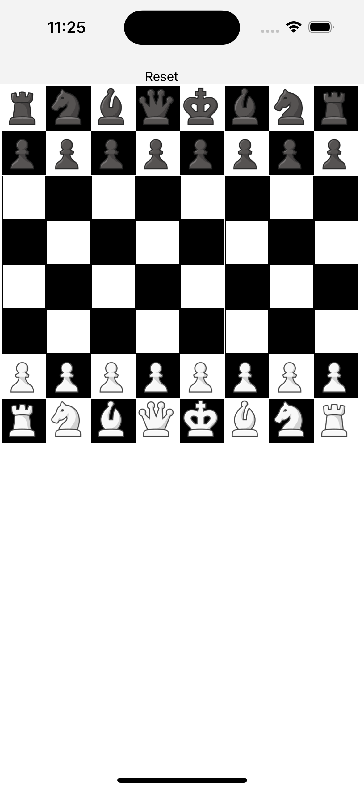

<div align="center">

# react-native-chessboardjs

A React Native chessboard with real drag and drop. Same API as [react-chessboard](https://github.com/Clariity/react-chessboard) v5, so web and mobile code read the same.



</div>

## Why

- **Pieces stay on top while dragging.** Every piece lives in one layer above the squares, so a dragged piece never slides under the board.
- **Smooth.** The dragged piece moves on the UI thread. React renders once when a drag starts and once when it ends.
- **No measuring.** The square under your finger is plain math from board width and orientation. Works inside scroll views, modals and rotated screens.
- **Feels like the web.** Same `options` object, same callbacks and arguments as react-chessboard v5.

## Requirements

Built for the latest stack only (Expo SDK 58 or equivalent):

| Package | Version |
| --- | --- |
| react | 19.3+ |
| react-native | 0.86+ (New Architecture) |
| react-native-gesture-handler | 3.3+ |
| react-native-reanimated | 4.7+ |
| react-native-worklets | 0.13+ |
| react-native-svg | 15.16+ |

Need an older stack? Use 0.4.x.

## Install

```sh
npx expo install react-native-chessboardjs react-native-gesture-handler react-native-reanimated react-native-worklets react-native-svg
```

Wrap your app in `GestureHandlerRootView` (Expo Router does this for you):

```tsx
import { GestureHandlerRootView } from 'react-native-gesture-handler';

export default function App() {
  return <GestureHandlerRootView style={{ flex: 1 }}>{/* ... */}</GestureHandlerRootView>;
}
```

## Usage

```tsx
import { useState } from 'react';
import { Chess } from 'chess.js';
import { Chessboard } from 'react-native-chessboardjs';

export function Game() {
  const [game] = useState(() => new Chess());
  const [fen, setFen] = useState(game.fen());

  return (
    <Chessboard
      options={{
        position: fen,
        onPieceDrop: ({ sourceSquare, targetSquare }) => {
          if (!targetSquare) return false;
          try {
            game.move({ from: sourceSquare, to: targetSquare, promotion: 'q' });
            setFen(game.fen());
            return true;
          } catch {
            return false; // illegal move, piece goes back
          }
        },
      }}
    />
  );
}
```

The board fills the width of its parent. Pass `boardWidth` to fix it.

## Options

All options are optional. Names and defaults match react-chessboard v5. Styles are React Native `ViewStyle` / `TextStyle`.

### Board

| Option | Type | Default | |
| --- | --- | --- | --- |
| `id` | `string` | `'chessboard'` | Prefix for testIDs. Use a unique id per board. |
| `position` | `string \| PositionDataType` | `'start'` | FEN string, `'start'`, or `{ e4: { pieceType: 'wP' } }`. |
| `boardOrientation` | `'white' \| 'black'` | `'white'` | |
| `boardWidth` | `number` | parent width | Mobile only. |
| `chessboardRows` | `number` | `8` | |
| `chessboardColumns` | `number` | `8` | |
| `pieces` | `PieceRenderObject` | `defaultPieces` | `{ wK: ({ size, square }) => <Svg … /> }` |
| `showNotation` | `boolean` | `true` | |

### Styles

| Option | Default |
| --- | --- |
| `boardStyle` | `{ overflow: 'hidden' }` |
| `squareStyle` | centered content |
| `squareStyles` | `{}`, per square, e.g. `{ e4: { backgroundColor: 'yellow' } }` |
| `darkSquareStyle` | `{ backgroundColor: '#B58863' }` |
| `lightSquareStyle` | `{ backgroundColor: '#F0D9B5' }` |
| `dropSquareStyle` | 1px black border on the square under the dragged piece |
| `draggingPieceStyle` | `{ transform: [{ scale: 1.2 }] }` |
| `draggingPieceGhostStyle` | `{ opacity: 0.5 }`, the piece left behind on its square |
| `darkSquareNotationStyle`, `lightSquareNotationStyle` | notation colors |
| `alphaNotationStyle`, `numericNotationStyle` | notation position and size |
| `squareRenderer` | `({ piece, square, children }) => ReactElement`. `children` is the square's notation. Pieces are drawn in their own layer above the squares. |

### Dragging

| Option | Type | Default | |
| --- | --- | --- | --- |
| `allowDragging` | `boolean` | `true` | |
| `allowDragOffBoard` | `boolean` | `true` | When false, the piece stays inside the board. |
| `dragActivationDistance` | `number` | `5` | Points the finger moves before a drag starts. Higher than web's `1` so taps and long presses register on touch. |
| `canDragPiece` | `({ isSparePiece, piece, square }) => boolean` | | |
| `onPieceDrag` | `({ isSparePiece, piece, square }) => void` | | Drag started. |
| `onPieceDrop` | `({ piece, sourceSquare, targetSquare }) => boolean` | | Return `true` to accept. `targetSquare` is `null` when dropped off the board. |
| `onPieceDragCancel` | `() => void` | | Drag interrupted by the system. |

### Taps

| Option | Type | |
| --- | --- | --- |
| `onPieceClick` | `({ isSparePiece, piece, square }) => void` | Tap on a piece. Fires before `onSquareClick`. |
| `onSquareClick` | `({ piece, square }) => void` | Tap on any square. Use with `squareStyles` for tap to move. |
| `onSquareLongPress` | `({ piece, square }) => void` | Hold still on a square. Mobile version of `onSquareRightClick`. |

### Animation

| Option | Type | Default | |
| --- | --- | --- | --- |
| `showAnimations` | `boolean` | `true` | Pieces slide when `position` changes, promotions included. A piece you just dropped does not slide again. |
| `animationDurationInMs` | `number` | `300` | |

### Arrows

Long press a square, then drag to another square to draw an arrow. Draw the same arrow again to remove it.

| Option | Type | Default | |
| --- | --- | --- | --- |
| `allowDrawingArrows` | `boolean` | `true` | |
| `arrows` | `Arrow[]` | `[]` | Your own arrows, `{ startSquare, endSquare, color }`. Drawn alongside the user's. |
| `arrowOptions` | `Partial<ArrowOptions>` | v5 defaults | Colors, width, length and opacity. On touch only `colors.default` is used. |
| `clearArrowsOnClick` | `boolean` | `true` | A tap clears drawn arrows. |
| `clearArrowsOnPositionChange` | `boolean` | `true` | |
| `onArrowsChange` | `({ arrows }) => void` | | The user's drawn arrows. |

### Coming in 1.1

`SparePiece` (drag pieces onto the board from outside it, for bughouse style drops).

### Not on mobile

Hover and mouse events (`onMouseOverSquare`, `onMouseOutSquare`, `onSquareMouseDown`, `onSquareMouseUp`), `allowAutoScroll`, and arrow modifier keys. `onSquareRightClick` becomes `onSquareLongPress`.

## ChessboardProvider

Same as v5. Wrap a board to share state, and read it with `useChessboardContext()`:

```tsx
<ChessboardProvider options={{ position: fen, onPieceDrop }}>
  <Chessboard />
</ChessboardProvider>
```

## Utils

Exported for building your own UI: `fenStringToPositionObject`, `generateBoard`, `getPositionUpdates`, `getPromotionUpdates`, `getRelativeCoords`, `getSquareOrigin`, `pointToSquare`, plus the row/column helpers from v5.

## Example app

`example/` is an Expo app that loads the library from `src`, so edits show up live.

```sh
yarn install
yarn example start   # Expo Go
yarn example ios     # dev build
```

## Migrating from 0.4

1.0 is a rewrite. Props moved into one `options` object that matches react-chessboard v5:

| 0.4 | 1.0 |
| --- | --- |
| `<Chessboard position onPieceDrop … />` | `<Chessboard options={{ position, onPieceDrop … }} />` |
| `onPieceDrop(source, target, piece)` | `onPieceDrop({ sourceSquare, targetSquare, piece })`, `piece.pieceType` is `'wP'` style |
| `isDraggablePiece({ piece })` | `canDragPiece({ piece, square, isSparePiece })` |
| `customDarkSquareStyle` / `customLightSquareStyle` | `darkSquareStyle` / `lightSquareStyle` |
| `customSquareStyles` | `squareStyles` |
| `customBoardStyle` | `boardStyle` |
| `size.width` | `boardWidth` |
| `whiteKingInCheck` / `blackKingInCheck` | `squareStyles` on the king's square |
| `onPromotionCheck`, promotion dialog | removed, handle promotion in your app (as on web) |
| premoves | removed, handle in your app (as on web) |
| `@mgcrea/react-native-dnd` dependency | gone |

## Credits

API and utils follow [react-chessboard](https://github.com/Clariity/react-chessboard) (MIT). Default pieces are the cburnett set (CC BY-SA 3.0, Colin M.L. Burnett).

## License

MIT
